<p align="center">
  <picture>
    <source media="(prefers-color-scheme: dark)" srcset="docs/assets/polaris-banner-white-animated.svg">
    
  </picture>
</p>

<p align="center">
  
  
  
  
  <a href="docs/README.md"></a>
  
  <a href="https://github.com/sponsors/4ltena"></a>
</p>

<p align="center">
  <strong>macOS TUI限定 · パッケージ未公開</strong> · <a href="CHANGELOG.md">変更履歴</a>
</p>

<p align="center">
  <strong>日本語</strong> · <a href="README.en.md" lang="en">English</a>
</p>

**polaris**は、作業に必要な文脈を選んでモデルへ渡すRust製のコーディングエージェントである。CLIとTUIを主な操作経路とし、macOS向けの作業画面も備える。ワークフローの段階（phase）を状態として保存し、その段階に必要な指示・skillを動的に組み立てる。既定では、各ターンの要求に「そのターンの入力」と「思い出した記憶」だけを送る（turn-only方式）。

- **v0.3.0-rcの提供範囲**：macOS arm64向けのTUIを配布対象とする（RCパッケージは現在未公開）。GUIおよび他OS向けのソースはリポジトリ内に保持するが、本バージョンの配布対象には含めない。
- **各種ドキュメント**：会話・巻戻し・MCP・subagentの操作は[利用ガイド](docs/usage.md)と[コマンド参照](docs/command-reference.md)、システム構成と提供範囲の詳細は[システム構成図](docs/system-overview.md)と[リリース資料](docs/releases/v0.3.0.md)を参照。

<p><a href="docs/releases/v0.3.0.md"></a></p>

<h2></h2>

> [!WARNING]
> 起動前に必ず**作業対象のプロジェクトディレクトリ**へ移動すること。ホームディレクトリ直下からの起動は、現在 `RuntimeDenied` で停止する（詳細は[起動時のトラブル](docs/usage.md#起動時のトラブル)を参照）。

### 1. ソースからビルドして実行する場合（推奨）

Rust `1.96.0` を用意する。導入済みの別バージョンと区別するため、実行時は `target/release/polaris` を直接指定する。

```sh
# ビルドとログイン（ChatGPT認証を使う例）
cargo build --release -p polaris-cli
target/release/polaris login

# 対話TUIで起動（引数を省略）
POLARIS_PROVIDER=codex target/release/polaris

# 段階（--phase）を指定して一発実行（-p）
POLARIS_PROVIDER=codex target/release/polaris --phase specify -p "機材貸出サービスの受入条件を整理する"
```

**プロバイダの選択と制約**
- **自動選択の優先順**：`POLARIS_PROVIDER` 未指定時は、OpenAI互換APIキーがあれば `openai`、APIキーがなく保存済みChatGPT認証があれば `codex` を選ぶ。いずれもなければ対話起動時にログイン画面を開く。
- **`openai` プロバイダの制約**：APIキー用の `openai` プロバイダは Chat Completions 形式のため、Responses API が必要な Astra の tool calling には未対応である。
- 認証・設定・会話の再開方法は[利用ガイド](docs/usage.md)を参照。

### 2. ローカル検証用パッケージ（macOS arm64）

ビルド済みCLIを同梱したローカル検証用パッケージ（`.pkg`）を作成し、取得した後に導入できる。利用者側にRust環境は不要。

```sh
sudo installer -pkg polaris-cli-preview-0.3.0-rc-arm64.pkg -target /
polaris
```

※ 現時点では未署名・未公開であり、実機へのインストール受入も未完了である。パッケージの組立て方法と検証範囲は[macOSの説明](apps/macos/README.md)を参照。

<h2></h2>

- **状態で管理するworkflow**：段階（phase）、作業、必要なskillを記録し、毎ターンの文脈を組み立てる。
- **会話の保存と分岐**：Sidechatで別文脈を分離し、保存済み会話を再開・分岐できる。TUIでは対象のユーザー入力より前へ、会話と作業ファイルを巻き戻せる。
- **ツールと委譲**：ファイル・Git・MCPの操作とsubagentへの委譲を共通の実行基盤で扱う。MCPの接続条件と操作権限を事前に検査する。
- **記憶と取得**：原文を保持し、直近のターンと過去の関連情報を必要に応じて取り出す。大きなツール結果は参照から再取得できる。
- **選べる型付き判断器**：Jev・SemIfを維持し、Clef/Clef-flashの固定profileとSystem One互換接続を共通の判断契約で扱う（既定は無効。容量帯は推薦の目安であり、backendを自動変更しない）。

> [!NOTE]
> **現在の提供状況と制約**
> - **型付き判断器**：Clefの本番受入profileはまだ0件であり、通常実行は未提供である（[設定と現在の制約](docs/usage.md#型付き判断器の設定)を参照）。
> - **macOSパッケージの同梱資源**：CLI専用プレビューパッケージには追加資源を含めない。GUIインストーラには固定manifestから `llama.cpp`、埋め込み実行環境、`multilingual-e5-small/base` を検証して `~/.polaris` へ取得する経路がある（Rustは任意選択）。SemIf用の `Qwen3.5-4B` は候補段階で、固定資源の登録と受入が未完了のため自動取得しない。署名済み配布資源と実機受入も未完了である（詳細は[macOSデスクトップ](apps/macos/README.md)を参照）。

<h2></h2>

2026-11-04に、Terminal-Bench v4.0の7課題を各1回、`gpt-6.1-sol`・`xhigh` の条件で測定した。`polaris（turn-only）` と `Codex 0.160.0` の比較結果は以下のとおり（v0.2.0時点の測定は[測定条件と結果](docs/preimplementation-evaluation.md#v0120とcodex-01540の途中結果)を参照）。

<p></p>

| 評価項目 | polaris（turn-only） | Codex 0.160.0 |
| --- | ---: | ---: |
| **テスト合格率** | **99.1〜99.3%** | 92.9〜93.0% |
| **全合格した課題** | **7課題中 5〜6** | 7課題中 3〜4 |
| **1課題あたりの費用**（API単価換算。プラン請求額ではない） | $0.377 | $0.362 |
| **1課題あたりの入力トークン** | **705,922** | 794,133 |
| **1課題あたりの要求数** | 24.1 | 20.6 |

**測定結果を読む際の注意点（限界）**
- **試行回数**：各課題を1回しか走らせていないため、この程度の差は実行ごとの揺れである可能性がある。
- **費用**：polarisの費用はCodexより約4%高い。
- **数値の幅**：範囲で示した値は、時間に依存する1つのテスト結果が採点のたびに入れ替わるためである。
- **turn-onlyの影響範囲**：ベンチマークの課題は1回のユーザーターンで完結する。そこではturn-onlyは何も切り捨てないため、合格率の差をturn-onlyの効果とは言えない。
  - ※ 長い会話での効果は別途測定しており、18ターンの会話では入力トークンが `841,289` から `96,215` に削減された（比較対象はCodexではなく以前のpolaris）。

<h2></h2>

目的別の入口は[文書一覧](docs/README.md)を参照。実測文書は対象バージョンと測定条件を確認のうえで参照されたい。

| 文書 | 内容 |
| --- | --- |
| [文書一覧](docs/README.md) | 現行ガイド、実装資料、過去の測定を目的別に整理。 |
| [利用ガイド](docs/usage.md) | 認証、起動トラブル、設定、envkit、会話操作。 |
| [コマンド参照](docs/command-reference.md) | CLI/TUIコマンドの役割と出力。 |
| [システム構成図](docs/system-overview.md) | 実行、保存、隔離、各crateの役割。 |
| [v0.3.0-rc](docs/releases/v0.3.0.md) | 配布範囲、候補checksum、検証結果と限界。 |

<h2></h2>

```sh
cargo test --locked --offline --workspace
cargo clippy --locked --offline --workspace --all-targets -- -D warnings
cargo fmt --all -- --check
```

<h2></h2>

- [openai/codex](https://github.com/openai/codex)：CLI・TUIの操作と挙動を比べる基準であり、一部の設計の参考にしている。

<h2></h2>

polarisが設計に取り入れた論文の要素を、実装状態ごとに示す。「計画」と「候補」はまだコードに存在しない。また、論文の実験結果はpolaris上では測り直していない。turn-onlyの設計根拠として検証した論文群は、本節の末尾にまとめる。

### 実装済み

- **確定事項の検査**：turn-onlyの記憶（[既定](docs/usage.md#1-polaris_turn_onlyturn-only-記憶方式)）は、各ターンを1行に圧縮した台帳を持つ。台帳の行に書かれた決定のうち、「照合できる語がすべてそのターンの原文にあり、利用者がそれを言ったか承認したもの」だけを確定事項として毎回の要求に載せる。判定にモデルは使わない。思い出すたびに根拠の原文が残っているかを確かめ、消えていれば根拠が無いと示す。
  - 出典：[Assay](https://arjmandi.github.io/assay/)（Arjmandi, 2026）
- **語による検索**：skillの検索、MCPツールの絞り込み、turn-onlyの索引において、入力との語の一致から近いものを選ぶ。
  - 出典：BM25（Robertson et al., Okapi at TREC-3, 1994）
- **順位の統合**：語（BM25）と埋め込みで得た2つの順位を、`1/(60+順位)` の和で1つに統合する。記憶の検索とturn-onlyの索引で使用する。
  - 出典：[RRF](https://doi.org/10.1145/1571941.1572114)（Cormack et al., 2009）

### 計画：turn-onlyの記憶の次の段階

- **話題の区切りと要旨**：話題が変わる箇所で会話を区切り、区切りごとに要旨と原文の位置を保持する。先に要旨を引き、必要なときだけ原文を開く。
  - 出典：[SeCom](https://arxiv.org/abs/2502.05589)（Pan et al., 2025）、[ReadAgent](https://arxiv.org/abs/2402.09727)（Lee et al., 2024）
- **有効期間つきの事実**：事実は1件につき1つの主張とし、「有効になった時点」と「どの事実に置き換えられたか」を持たせる。古い事実は消去しない。
  - 出典：[Zep](https://arxiv.org/abs/2501.13956)（Rasmussen et al., 2025）、[Chronos](https://arxiv.org/abs/2603.16862)（Sen et al., 2026）
- **あらすじの差分更新**：毎回載せる短いあらすじを、丸ごと書き直さずに差分で積み上げる。書き直しを重ねると細部が失われる（context collapse）という報告に基づく。
  - 出典：[ACE](https://arxiv.org/abs/2510.04618)（Zhang et al., 2025）
- **記憶どうしのリンク**（任意の段階）：関係の種類と理由を付与し、記憶を互いに結ぶ。
  - 出典：[A-MEM](https://arxiv.org/abs/2502.12110)（Xu et al., 2025）
- **更新と時系列の測定**：各段階を、事実の更新と時系列を問う課題で測定する。問いの種類は論文の分類に倣う。
  - 出典：[LongMemEval](https://arxiv.org/abs/2410.10813)（Wu et al., 2024）

### 計画：v2.0.0以降

- **ハーネスの自己改良**：現在人が回している「測定・原因調査・修正」のサイクルを、polaris自身が回す。実行記録から失敗の型を見つけ、型ごとに小さな修正案を出し、改良に使っていない課題を悪化させない案だけを回帰試験で残す。
  - 出典：[Self-Harness](https://arxiv.org/abs/2606.09498)（Zhang et al., 2026）
- **改良案を作るモデル**：改良案は安価なモデルで作成し、費用は課題を解く側に回す。改良案を作る力はモデルの強さにあまり依存しないという報告に基づく。
  - 出典：[Harness Updating Is Not Harness Benefit](https://arxiv.org/abs/2605.30621)（Lin et al., 2026）

### 候補

- **繰り返し引かれるチャンクの抑制**：引用に載った回数に応じて、次のターンからそのチャンクの順位を下げる。どの問いにも当たるチャンクを下げ、その陰に隠れた根拠を上位に出すためである（モデルは呼ばない）。抑制しない場合と比較測定し、採用するかを決める。
  - 出典：[AMIE](https://arxiv.org/abs/2610.34977)（Hu et al., 2026）

<details>
<summary><strong>turn-onlyの設計の根拠として確かめた論文（29編）</strong></summary>

<br>

turn-onlyにおける5つの設計判断ごとに、支持する研究と、限定または反証する研究を挙げる。すべての論文について、arXivのページで題名・著者・主張を確認した。なお、コーディングエージェントの課題で測定した論文や、日本語で測定した論文は存在しない。想起（recall）に関する研究の多くは、8B以下のモデルを対象としている。

#### 1. 正確な文字列（名前・パス・識別子）を、モデルの外の辞書に置く
- **支持**：
  - 固定サイズの状態を持つモデル（SSM・線形注意）は、文脈内の文字列を正確に思い出したり写したりする課題で、attentionを使うモデルに劣る（[Repeat After Me](https://arxiv.org/abs/2402.01032)、[Zoology](https://arxiv.org/abs/2312.04927)、[Based](https://arxiv.org/abs/2402.18668)、[Gated Delta Networks](https://arxiv.org/abs/2412.06464)、[Waleffe et al.](https://arxiv.org/abs/2406.07887)、[RULER](https://arxiv.org/abs/2404.06654)）。
  - 入れ子の鍵の検索でGPT-4が正答できなくなる条件でも、外部の記憶から引き直す [MemGPT](https://arxiv.org/abs/2310.08560) は影響を受けなかった。
  - 索引の鍵を抜き出した語句だけにするより、元の文も持たせるほうがよく引ける（[LongMemEval](https://arxiv.org/abs/2410.10813)）。
  - 線形注意の状態に正確な記憶を足す方式は、同じ考え方をモデル内部で実現する。ただし学習を要する（[HOLA](https://arxiv.org/abs/2607.02303)）。
- **限定**：
  - 短い文字列1つなら、学習した長さの中ではほぼ正確に引ける（[Stuffed Mamba](https://arxiv.org/abs/2410.07145)）。
  - 文脈を2回読ませると差は縮むが、依然として残る（[Just read twice](https://arxiv.org/abs/2407.05483)）。
  - attentionの層を少し混ぜると、差は大きく縮む（Zoology、Waleffe et al.）。

#### 2. 履歴を逐語で持たず、1ターン1行の台帳と、会話の方向をまとめた1行（方向の行）にする
- **支持**：
  - 指示を複数のターンに分けると性能が落ち、1つにまとめ直すと回復する（[LLMs Get Lost In Multi-Turn Conversation](https://arxiv.org/abs/2505.06120)）。
  - 入力が長いだけで、検索が完全であっても性能が落ちる（[Context Length Alone Hurts](https://arxiv.org/abs/2510.05381)）。
  - 関連する情報が文脈の中ほどにあると、精度が落ちる（[Lost in the Middle](https://arxiv.org/abs/2307.03172)）。
  - 公称の文脈長と、性能を保てる長さは一致しない（RULER）。
  - 長い履歴を丸ごと読ませると、根拠だけを渡す場合より正答率が下がる（LongMemEval、[Zep](https://arxiv.org/abs/2501.13956)）。
  - 長い検索の軌跡では、要約や切り詰めが精度を上げた（[Context Rot](https://arxiv.org/abs/2606.29718)）。
  - 前の記憶と新しい対話から短い記憶を書き直し続ける方式が、「方向の行」に最も近い先例である（[Recursively Summarizing](https://arxiv.org/abs/2308.15022)）。
- **限定・反証**：
  - 反復する圧縮は直近のやり取りの影響を弱め、実行の不安定さを増やした（[Min et al.](https://arxiv.org/abs/2608.06503)、反証）。
  - 過去の応答を固定の文に置き換えると、コードの課題では悪化した（[What if LLMs Ate Their Words](https://arxiv.org/abs/2609.05882)）。
  - 複数ターンの入力を完全な指示に書き直すと性能は戻るが、単純な要約やMem0ではほとんど戻らない（[Intent Mismatch](https://arxiv.org/abs/2602.07338)）。
  - LoCoMoでは逐語の全履歴が最も正確であり、[Mem0](https://arxiv.org/abs/2504.19413) の利点は費用と遅延の削減にあった。
  - アシスタント側の細部は、圧縮で抜け落ちやすい（Zep）。
  - 直近3ターンだけを残す切り詰めも、要約と同程度に効いた（Context Rot）。

#### 3. 語と埋め込みで原文のチャンクを引き、出典をつける
- **支持**：
  - まれな実体を問う質問ではBM25が密ベクトル検索に勝ち、Natural Questionsでは逆になる（[Simple Entity-Centric Questions](https://arxiv.org/abs/2109.08535)）。
  - 生のやり取りを値として持ち、抜き出した事実を鍵に足す構成が最も優れていた（LongMemEval）。
  - 問いに合わせて抜き出す圧縮は、問いと無関係に作った要約を上回る（[Jha et al.](https://arxiv.org/abs/2407.08892)、[LongLLMLingua](https://arxiv.org/abs/2310.06839)）。
  - 出典を挙げる回答は、全文を渡すより、絞って渡すほうが引用が正確になる（[Summary of a Haystack](https://arxiv.org/abs/2407.01370)）。
  - 要約と原文を同じ候補に入れて引くと、要約も原文も引かれる（[RAPTOR](https://arxiv.org/abs/2401.18059)）。polarisが台帳の古い行をチャンクと同じ索引に入れるのも、これと同じ形である。
- **限定**：
  - BM25と埋め込みの融合そのものを比較した論文は、確認した範囲には無い。
  - 自然文の質問では、密ベクトル検索がBM25を上回る（LongMemEval、LongLLMLingua）。
  - 入力が検索の鍵に向かない場合、検索は逆効果になる（Recursively Summarizing）。
  - 評価はいずれも英語の質疑・対話・文書であり、コードやパスを含まない。

#### 4. 決定的な検査を通った事実だけを、確定事項に入れる
- **支持**：
  - 記憶の方式では、モデルによる抽出と更新の段階で幻覚（ハルシネーション）が生じ、積み重なる（[HaluMem](https://arxiv.org/abs/2511.03506)）。
  - SSMの誤りは、正解に近い文字列の形で出る（Waleffe et al.）。この形の誤りは、文字列の完全一致で検出できる。
  - モデルの判定を使わずに、抜き出した文書IDを正解と照合して引用を採点した先例がある（Summary of a Haystack）。
- **限定**：
  - 候補を抜き出して既存の記憶と照らす流れ（Mem0）や、矛盾した事実を失効させる仕組み（Zep）は近いが、それらの判断はモデルが行う。決定的な検査で事実を確定する方式を評価した論文は、確認した範囲には無い。

#### 5. 要約だけに頼らず、原文を引き直せるようにする
- **支持**：
  - 損失のある要約だけを見る方式は、全履歴を引ける方式より大きく劣った（MemGPT、Zep）。
  - 要旨だけでは全文より劣るが、原文を1〜2ページ引き直すと全文と同程度になった（[ReadAgent](https://arxiv.org/abs/2402.09727)）。
  - 再帰的な要約では、関連する情報が数段で失われる（[Walking Down the Memory Maze](https://arxiv.org/abs/2310.05029)）。
  - 要約や事実で原文を置き換えると、質疑の正答率が下がった（LongMemEval）。
- **限定**：
  - MemGPTの差は、全文脈ではなく「要約だけ」との比較である。
  - 会話が文脈長に収まるなら、全会話をそのまま渡しても同程度であった（Zep）。
  - 単純な切り詰めが要約と同程度に効いた例もある（Context Rot）。

</details>

<h2></h2>

[MIT License](LICENSE)で公開する。TLSテスト素材の出典と許諾は[fixtureの説明](crates/polaris-http/src/fixtures/README.md)を参照。